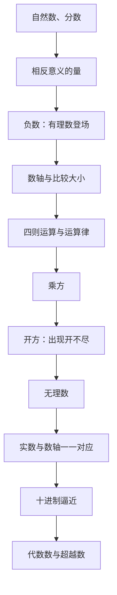

# 有理数与无理数 点化学习系统

## 这本书在讲什么
这本书回答一个问题：我们熟悉的数为什么不够用。每一次扩充都不是为了好玩——负数是“相反意义的量”逼出来的，无理数是“开不尽”逼出来的。扩充之后要重新检查三件事：还能不能比大小、四则运算还封闭吗、数轴上的点是不是都填满了。主线就沿着这三件事往下走。

## 全书心智模型

## 学习路径（推荐顺序）
| 步骤 | 章节 | 主题 | 前置 | 检查点 |
|---|---|---|---|---|
| 01 | ch01 | 有理数的概念与数轴 | 四则运算、分数 | 能说出 -a 与 |a| 的区别，能在数轴上标出 -7/3 |
| 02 | ch02 | 有理数的四则运算 | ch01 | 能用分配律解释“负负得正”，能算含分数的混合运算 |
| 03 | ch03 | 乘方与开方 | ch02 | 能区分 (-2)^4 与 -2^4，能判断一个方根开得尽还是开不尽 |
| 04 | ch04 | 无理数与实数 | ch03 | 能独立写出 √2 不是有理数的反证 |
| 05 | ch05 | 逼近、代数数与超越数 | ch04 | 能说清截断序列的误差为什么小于 10^-n |

## 章节索引
- 第 1 章：有理数的概念与数轴（难度 ★）→ chapters/ch01-rational-number-axis.md
- 第 2 章：有理数的四则运算（难度 ★★）→ chapters/ch02-arithmetic.md
- 第 3 章：乘方与开方（难度 ★★）→ chapters/ch03-power-root.md
- 第 4 章：无理数与实数（难度 ★★★）→ chapters/ch04-irrational-real.md
- 第 5 章：逼近、代数数与超越数（难度 ★★★）→ chapters/ch05-approximation-transcendental.md

## 前置知识（零基础缺口补讲）
| 缺口 | 对应补讲位置 | 学完标志 |
|---|---|---|
| 绝对值与相反数分不清 | ch01「相反数与绝对值」 | 能举例说明 -a 不一定是负数 |
| 不会用反证法 | ch04「√2 不是有理数」 | 能自己写出“假设—推出矛盾—否定假设”三步 |
| 不知道开方是乘方的逆运算 | ch03「开方与算术根」 | 能由 x^3=-8 直接说出 x=-2 |

## 术语 / 模式 / 速查入口
- 术语表 → glossary.md
- 模式库 → patterns.md
- 速查表 → cheatsheet.md
- 测验 → quiz.md
- 抽认卡 → flashcards.md
