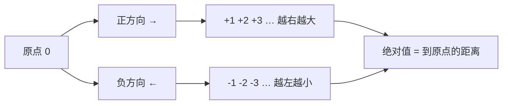

# 第 1 章：有理数的概念与数轴

- **难度**：★☆☆ ｜ **预估学时**：2 小时 ｜ **前置**：四则运算、分数、数数

## 学习目标
学完本章，你能：
- 用“相反意义的量”解释负数是怎么被引进来的
- 分清整数、分数、有理数的范围，知道 0 的位置
- 能在数轴上定位一个有理数并比较两个负数的大小

## 一句话核心
有理数就是能写成两个整数之比的数；数轴把这套数按大小排成一条线，右边的永远比左边大。

## 零基础讲解
### 1.1 负数不是凭空规定的

先看两个场景。

汽车从同一地点出发，一辆向东走 5 公里到 A 地，一辆向西走 5 公里到 B 地。两辆车走过的路程都是 5 公里，但方向相反。如果只写一个“5”，A 和 B 就分不出来了。

温度从 5 ℃ 降到 2 ℃，写成 5−2=3 没问题；但如果从 2 ℃ 降到 5 ℃ 以下，比如降到零下 3 ℃，用原来的数算 2−5 就没有意义了。

这两个场景的共同点是：**量的两个方向（两种相反意义）需要两个不同的记号**。做法是：规定其中一种意义为正，另一种为负。向东记作正，向西 5 公里就记作 −5 公里；零上记作正，零下 3 ℃ 就记作 −3 ℃。

规定哪一边为正**不是绝对的**——规定向西为正也完全成立，只是不符合习惯。一旦定了，另一边就必须为负，不能两边都算正。

### 1.2 正数、负数、零

在原来的数（0 除外）前面放上“−”号得到的数叫**负数**，如 −5、−3/4、−10.05。原来的那些数（0 除外）叫**正数**，如 5、3/4、10.05。正数前的“+”可以省略，+5 和 5 是同一个数。

**0 既不是正数也不是负数**，它是正负之间的界线。0 也不能简单理解成“没有”：0 ℃ 不是没有温度，而是标准大气压下冰水混合的那个确定温度。

### 1.3 有理数包括哪些

- 正整数、0、负整数，统称**整数**；
- 正分数、负分数，统称**分数**；
- 整数和分数合起来叫**有理数**。

所以有理数就是一切能写成 m/n 形式的数，其中 m、n 是整数且 n≠0。有限小数（如 0.25=1/4）和循环小数（如 0.333…=1/3）都是有理数。

### 1.4 数轴：给每个数找一个位置

画一条直线，指定：

1. **原点**（对应 0 的那个点）；
2. **正方向**（通常向右，画箭头）；
3. **单位长度**（一个固定的长度算作 1）。

这条线就是数轴。每个有理数都能在数轴上找到一个点：正数在原点右边，负数在左边，到原点的距离由绝对值决定。

反过来要注意：数轴上的点**不一定**都是有理数。这条“填不满”的缝，第 4 章会用 √2 补上。

### 1.5 相反数与绝对值

**相反数**：a 的相反数是 −a。注意 −a 不一定是负数——当 a=−3 时，−a=3 是正数；当 a=0 时，−a=0。

**绝对值**：|a| 表示数轴上表示 a 的点到原点的距离，所以 |a|≥0 恒成立。|−3|=3，|3|=3，|0|=0。

两者关系：|a| 就是 a 与 −a 中那个非负的数。

### 1.6 比较大小

规则只有一条：**数轴上右边的数比左边的大**。由此得到三条常用结论：

- 任何正数 > 0 > 任何负数；
- 两个负数比大小，绝对值大的反而小（因为它离原点更远、位置更靠左）；
- 比较分数可以先通分，也可以化成小数（但循环小数要当心精度）。

例：比较 −7/8 与 −6/7。通分：−49/56 与 −48/56。因为 49>48，所以 −49/56 < −48/56，即 −7/8 < −6/7。

## 图示

**看图说明**：看这条轴：箭头定正方向，格子定单位长度；绝对值只量距离、不看方向，所以 |−3|=|3|。

## 类比与实例
**类比**：数轴像一把有刻度的尺子，0 是零点，往右是“正”的一侧，往左是“负”的一侧。尺子上的每个刻度都对应一个数。

**失效边界**：这把尺子只有有理数刻度时，某些长度（比如边长为 1 的正方形的对角线）量不出来——第 4 章会看到，这个长度 √2 不在尺子的刻度里。

**实例**：某地一天的气温从 −3 ℃ 升到 7 ℃，温差是多少？
解：温差 = 7−(−3) = 7+3 = 10（℃）。用数轴看，就是从 −3 这个点向右移动 10 格到达 7。

## 常见误解
- 别以为 −a 一定是负数 —— 实际上 a 本身可能是负数或 0：a=−3 时 −a=3，a=0 时 −a=0。符号“−”在这里表示“取相反数”，不是“一定是负”。
- 别以为 |a| 一定等于 a —— 实际上 只有 a≥0 时 |a|=a；a<0 时 |a|=−a。绝对值的结果永远非负，a 本身可正可负。
- 别以为 0 就是“没有” —— 实际上 0 是一个确定的数，表示正负的分界，也对应数轴上的原点、0 ℃ 这样的具体状态。

## 自测题（答案）
1. 下列各数中，是负有理数的是：
   A. −3/4 ｜ B. 0 ｜ C. |−2| ｜ D. −(−5)
   **答案**：A ｜ **解析**：−3/4 是负分数，属有理数。0 不是负数；|−2|=2 是正数；−(−5)=5 是正数。
2. 比较 −7/8 与 −6/7 的大小，正确的是：
   A. −7/8 > −6/7 ｜ B. −7/8 < −6/7 ｜ C. −7/8 = −6/7 ｜ D. 无法比较
   **答案**：B ｜ **解析**：通分得 −49/56 与 −48/56。两负数比较，绝对值大的反而小，49>48，所以 −7/8 < −6/7。

## 复习锚点
- 有理数 ⇔ 能写成 m/n（n≠0）
- 数轴三要素：原点、正方向、单位长度
- |a| 是距离，恒 ≥0；−a 只是“取相反”
