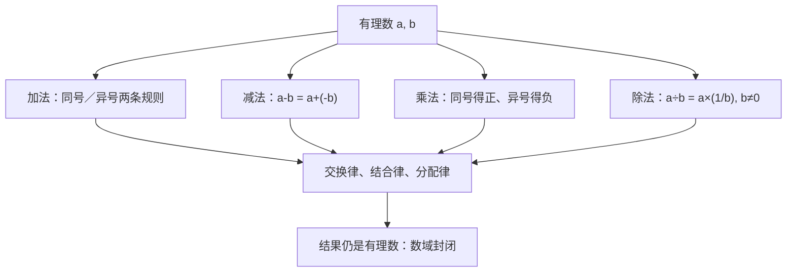

# 第 2 章：有理数的四则运算

- **难度**：★★☆ ｜ **预估学时**：3 小时 ｜ **前置**：ch01、分数运算

## 学习目标
学完本章，你能：
- 按符号规则正确做有理数加减乘除
- 用分配律自己推出“负负得正”，而不是背结论
- 解释为什么有理数集对四则运算封闭（除数不为 0）

## 一句话核心
减法是加相反数，除法是乘倒数；所有符号规则都由分配律推出来，不是额外规定。

## 零基础讲解
### 2.1 加法：两条规则

- **同号相加**：取相同的符号，绝对值相加。如 (−7)+(−4)=−11。
- **异号相加**：取绝对值较大的那个数的符号，用较大的绝对值减去较小的绝对值。如 (−7)+4=−3。

再加两条特殊情形：a+0=a；互为相反数的两个数相加得 0。

### 2.2 减法就是加相反数

> a − b = a + (−b)

所以 (−7)−4=(−7)+(−4)=−11；(−7)−(−4)=(−7)+4=−3。减法不需要另立一套符号规则。

### 2.3 乘法：符号怎么定

- 同号得正，异号得负；
- 任何数与 0 相乘得 0；
- 绝对值相乘。

于是 (−2)(−3)=6，(−2)(3)=−6。

**“负负得正”不是硬规定的**，它可以从分配律推出来：

展开：(−a)[(−b)+b] = (−a)(−b) + (−a)b = 0，所以 (−a)(−b) = ab。

所以 (−a)(−b)=−(−a)b=ab。也就是说，只要承认分配律，负负得正就是唯一不矛盾的选择。

### 2.4 除法就是乘倒数

a ÷ b = a × (1/b)（b ≠ 0）

符号规则与乘法相同：同号得正、异号得负。除以一个数等于乘它的倒数，所以**除数不能为 0**——0 没有倒数。

### 2.5 运算律与“数域”

加法满足交换律、结合律；乘法满足交换律、结合律；乘法对加法满足分配律。

正因为有这些运算律，有理数集对加、减、乘、除（除数≠0）是**封闭**的：算来算去还是有理数。数学上把这样的数集叫**数域**。这一点很关键——第 3 章开方就会发现，封闭性在这里第一次被打破。

## 图示

**看图说明**：看这张图：四条运算最终都落在同一组运算律上，封闭性是由“结果仍属于有理数集”体现的。

## 类比与实例
**类比**：正负号像“方向牌”。同向走两步是加速（同号得正），反向走是被抵消（异号得负）；乘法的符号规则相当于“转向两次回到原方向”。

**失效边界**：这个类比只管符号方向，不管大小；绝对值部分仍要单独算。

**实例**：计算 −3/4 + 5/6 − 1/2。
通分（分母 12）：−9/12 + 10/12 − 6/12 = (−9+10−6)/12 = −5/12。

## 常见误解
- 别以为 “负负得正”是人为规定、没有道理 —— 实际上 它可以由分配律推出：由 (−a)[(−b)+b]=0 得 (−a)(−b)=ab。承认分配律，就没有别的选择。
- 别以为 减一个负数等于减一个正数 —— 实际上 减去负数等于加上它的相反数：a−(−b)=a+b。例如 5−(−3)=8。
- 别以为 除以 0 也能算，只是结果很大 —— 实际上 0 没有倒数，a÷0 在有理数里没有定义；这不是“算不出来”，而是运算本身不成立。

## 自测题（答案）
1. 计算 (−2)(−3)+(−4) 的结果是：
   A. −10 ｜ B. 2 ｜ C. 10 ｜ D. −2
   **答案**：B ｜ **解析**：(−2)(−3)=6（同号得正），再加 −4 得 2。
2. 下列运算中，能说明有理数集对除法不封闭的是：
   A. 3÷4=3/4 ｜ B. (−6)÷2=−3 ｜ C. 5÷0 没有意义 ｜ D. 0÷7=0
   **答案**：C ｜ **解析**：封闭要求“任意两个元素运算后仍在集合内”。5÷0 因为除数没有倒数而不成立，说明除法必须把 0 排除在外。

## 复习锚点
- a−b=a+(−b)，a÷b=a×(1/b)
- 符号规则来自分配律，不是额外约定
- 有理数集是数域，除法要求除数≠0
