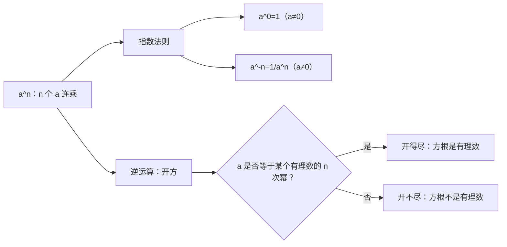

# 第 3 章：乘方与开方

- **难度**：★★☆ ｜ **预估学时**：3 小时 ｜ **前置**：ch02

## 学习目标
学完本章，你能：
- 说清 a^n 的定义与符号规律，分清 (−2)^4 与 −2^4
- 由指数法则推出 a^0=1 与 a^-n=1/a^n
- 判断一个方根开得尽还是开不尽

## 一句话核心
乘方是相同因数连乘的简写；开方是它的逆运算——开得尽时结果是有理数，开不尽时结果就跳出有理数集。

## 零基础讲解
### 3.1 乘方的定义

a^n = a × a × … × a（n 个 a 相乘）

a 叫底数，n 叫指数，结果叫幂。n 是正整数时这是“连乘”的缩写。

符号规律：

- 正数的任何次幂都是正数；
- 负数的偶次幂是正数，奇次幂是负数；
- 0 的正整数次幂是 0。

所以 (−2)^4=16，而 (−2)^3=−8。

**注意括号**：(−2)^4 表示“−2 这个数”的四次幂，等于 16；−2^4 表示“2 的四次幂取相反数”，等于 −16。差一对括号，结果差一个符号。

### 3.2 指数法则

a^m × a^n = a^(m+n)；(a^m)^n = a^(mn)；(ab)^n = a^n × b^n

这三条在正整数指数下可以直接由“连乘”验证。

### 3.3 零指数与负指数

要让 a^m/a^n=a^{m−n} 在 m=n 时也成立，必须有 a^0=1（a≠0）。

要让它在 m<n 时也成立，必须有

a^(−n) = 1 / a^n（a ≠ 0）

这两条不是新规定，而是“让指数法则不出现例外”的唯一选择。

### 3.4 开方与算术根

如果 x^n=a，就说 x 是 a 的一个 n 次方根。求方根的运算叫开方，它是乘方的逆运算。

- n 为偶数时，a>0 有两个 n 次方根，互为相反数；其中非负的那个叫**算术根**，记作 ⁿ√a；
- n 为奇数时，a 的 n 次方根只有一个，符号与 a 相同。

例如 √81=9（算术根，另一个根是 −9）；∛(−8)=−2；√0=0。

### 3.5 开得尽与开不尽

如果 a 能写成某个有理数的 n 次幂，方根就是有理数，叫“开得尽”。例如 81=9^2，所以 √81=9。

如果开不尽，结果就**不是有理数**。例如 2 不是任何有理数的平方，√2 就不在有理数集里。这正是下一章的入口。

## 图示

**看图说明**：看这个判断分支：开方是否留在有理数集里，取决于被开方数是不是有理数的 n 次幂，而不取决于我们算得够不够快。

## 类比与实例
**类比**：乘方像“把一个数按倍数叠高”，开方像“问这个高度是几层叠出来的”。叠得整齐（开得尽）就有整数答案，叠得不整齐（开不尽）就没有有理答案。

**失效边界**：这个类比默认“层数”是整数；一旦允许分数指数，乘方与开方的界线就模糊了。

**实例**：判断 √36、√50、∛27 是否开得尽。
√36=6（36=6^2，开得尽）；∛27=3（27=3^3，开得尽）；√50 开不尽——因为 50 介于 7^2=49 与 8^2=64 之间，且 50 不是任何有理数的平方。

## 常见误解
- 别以为 (−2)^4 与 −2^4 是一回事 —— 实际上 前者是 (−2)^4=16，后者是 −(2^4)=−16。括号决定“负号属于底数还是属于整个幂”。
- 别以为 a^0=0 —— 实际上 a^0=1（a≠0）。由 a^n/a^n=1 与指数法则相减即可得到；0^0 无定义。
- 别以为 √a 一定是正数 —— 实际上 算术根非负，但方程 x^2=a 有两个根 ±√a；说“方根”时必须区分“算术根”和“全部根”。

## 自测题（答案）
1. 下列各式中值等于 −16 的是：
   A. (−2)^4 ｜ B. −2^4 ｜ C. (−4)^2 ｜ D. 2^4
   **答案**：B ｜ **解析**：−2^4 表示 2 的四次幂取相反数，等于 −16；(−2)^4=16，(−4)^2=16，2^4=16。
2. 下列方根中，结果不是有理数的是：
   A. √49 ｜ B. ∛(−27) ｜ C. √2 ｜ D. √0.25
   **答案**：C ｜ **解析**：√49=7；∛(−27)=−3；√0.25=0.5；而 2 不是任何有理数的平方，√2 不是有理数。

## 复习锚点
- a^n 是连乘的缩写，括号决定负号归属
- a^0=1、a^-n=1/a^n 由指数法则逼出来
- 开得尽 ⇔ 被开方数是有理数的 n 次幂
