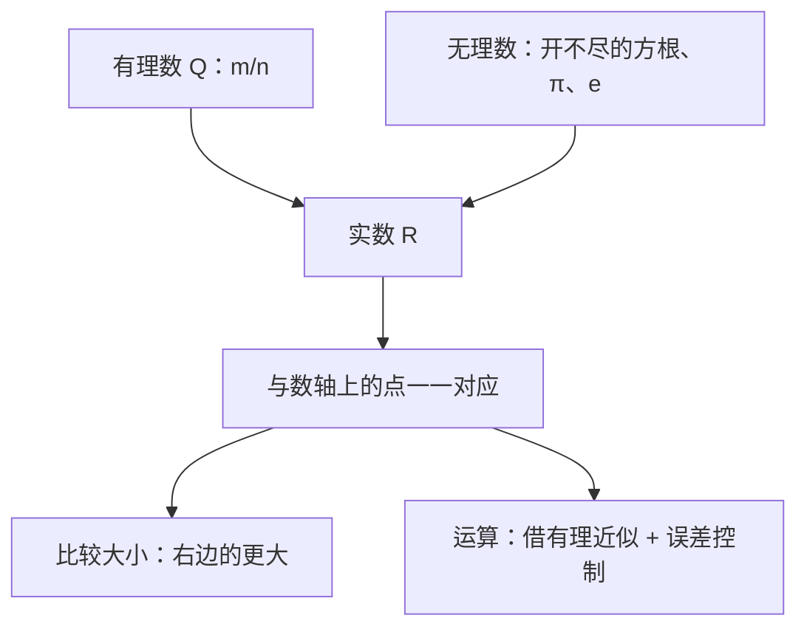

# 第 4 章：无理数与实数

- **难度**：★★★ ｜ **预估学时**：3 小时 ｜ **前置**：ch03

## 学习目标
学完本章，你能：
- 写出 √2 不是有理数的完整反证
- 说出无理数的两类常见来源
- 解释实数与数轴上的点为什么一一对应

## 一句话核心
开不尽的方根不能写成两个整数之比，这类数叫无理数；有理数与无理数合起来是实数，实数把数轴填满了。

## 零基础讲解
### 4.1 √2 不是有理数

假设 √2 是有理数，那么它可以写成最简分数

√2 = m / n

其中 m、n 是正整数且互质（没有公因数）。

两边平方：2=m²/n²，即

m² = 2n²

右边是偶数，所以 m² 是偶数，于是 m 是偶数。设 m=2k，代入得 4k²=2n²，即 n²=2k²，同理 n 也是偶数。

m、n 都是偶数，与“互质”矛盾。所以假设不成立，√2 不是有理数。

这个证明只用了一条性质：**平方为偶数的整数必为偶数**。

### 4.2 无理数的两类来源

1. **开不尽的方根**：√2、√3、∛5 等；
2. **圆周率 π 这一类**：它不是任何整系数多项式方程的根（第 5 章会给出这个说法的名字：超越数）。

无理数的共同点是：写成小数既不终止也不循环。√2=1.41421356…，π=3.14159265…，都看不到循环节。

### 4.3 实数与数轴

有理数和无理数合起来叫**实数**。实数的关键性质是：

> 数轴上的每一个点都对应一个实数，每一个实数都对应数轴上的一个点。

这叫“一一对应”。第 1 章说过有理数在数轴上填不满，现在这些缝隙被无理数补上了。

### 4.4 实数的大小与运算

实数比较大小仍然看数轴：右边的更大。具体操作时常用有理数近似：要比较 √2 与 1.414，只需比较它们的平方（都是正数，平方保序）：2 > 1.414²=1.999396，所以 √2>1.414。

实数的加、减、乘、除（除数非零）仍然封闭，实数集也是数域；运算时常用“取到足够精度的有理近似”来算，结果再用误差控制说明可靠性。

## 图示

**看图说明**：看这张图：实数不是“又一种数”，而是有理数与无理数的并集；一一对应是它最关键的结构性质。

## 类比与实例
**类比**：有理数像尺子上刻好的刻度，无理数像刻度之间的“缝”。缝看不见，但量对角线时就会暴露——边长为 1 的正方形，对角线长 √2，任何刻度都量不准。

**失效边界**：这个类比只在“一维数轴”上成立；到了二维平面，“点”和“数”的对应要换成“点”和“数对”。

**实例**：比较 √3 与 1.7 的大小。
两边都是正数，平方保序：3 与 2.89 比较，3>2.89，所以 √3>1.7。

## 常见误解
- 别以为 无理数就是“开不尽的数” —— 实际上 开不尽的方根只是无理数的一类；π、e 这类超越数同样是无理数，但不是方根形式。
- 别以为 无限小数都是无理数 —— 实际上 0.333…=1/3 是无限循环小数，属有理数。只有“不循环”的无限小数才是无理数。
- 别以为 实数比有理数“多一些”，结构差不多 —— 实际上 实数与数轴一一对应、且是完备的（没有缝隙）；有理数虽然稠密，但有缝隙，这是本质差别。

## 自测题（答案）
1. “√2 不是有理数”的反证中，关键矛盾是：
   A. m、n 都很大 ｜ B. m、n 同為偶数，与互质矛盾 ｜ C. √2 是无限小数 ｜ D. 2 不是平方数
   **答案**：B ｜ **解析**：由 m²=2n² 推出 m 偶，再由 m=2k 推出 n 偶，于是 m、n 有公因数 2，与“最简分数”矛盾。
2. 下列数中是无理数的是：
   A. 0.121212…（循环） ｜ B. √16 ｜ C. π ｜ D. 22/7
   **答案**：C ｜ **解析**：循环小数是有理数；√16=4；22/7 是分数；π 不是任何整系数多项式方程的根，是无理数（超越数）。

## 复习锚点
- √2 无理性的证明：平方 → 偶性 → 与互质矛盾
- 实数 = 有理数 ∪ 无理数，与数轴一一对应
- 无限不循环小数 ⇔ 无理数
