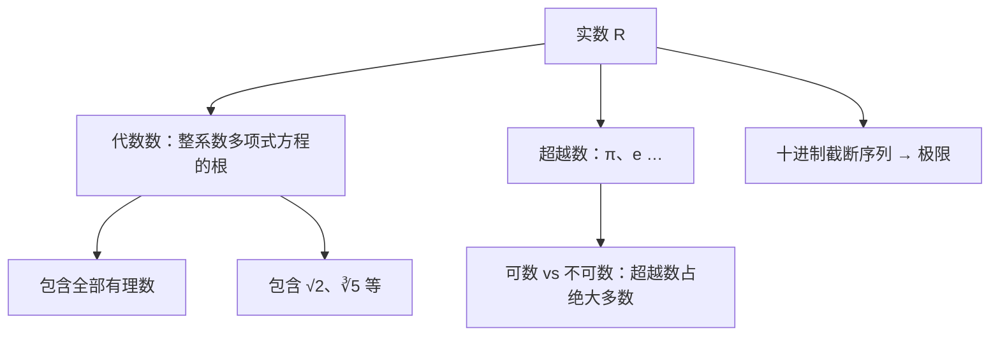

# 第 5 章：逼近、代数数与超越数

- **难度**：★★★ ｜ **预估学时**：3 小时 ｜ **前置**：ch04

## 学习目标
学完本章，你能：
- 写出 √2 的十进制截断序列并估计误差
- 说明代数数与超越数的区别，各举两例
- 用“可数／不可数”解释超越数为什么大量存在

## 一句话核心
无理数用有理数列逼近，误差随位数缩小到任意小——这就是极限的雏形；能当整系数多项式方程的根的叫代数数，当不了的叫超越数。

## 零基础讲解
### 5.1 十进制截断序列

把 √2 的小数一位位截下来：

1.4，1.41，1.414，1.4142，……

第 n 个截断值记作 x_n，它满足

0 ≤ √2 − x_n < 10^(−n)

所以 n 越大，误差越小，想多小就多小。这个“要多大精度就给多大精度”的性质，就是后面极限概念的起点。

### 5.2 误差估计怎么用

比如要保证误差小于 0.001，取 n=3 就够：x_3=1.414，误差小于 10^-3。

实际计算时还要注意：截断是“向下取”，所以 x_n 总是比 √2 小；如果四舍五入，误差可能正也可能负，估计时要加绝对值。

### 5.3 最佳渐近分数

除了十进制，还可以用分数逼近。把 √2 展开成连分数，得到

1，3/2，7/5，17/12，41/29，……

这些分数叫 √2 的渐近分数。它们的误差比同分母的其他分数都小，所以叫“最佳”。原书第 14 节给出了这套分数的构造与误差比较。

### 5.4 代数数

如果一个数能是某个整系数多项式方程的根，它就叫**代数数**。

- √2 是 x²−2=0 的根，是代数数；
- 黄金比 (1+√5)/2 是 x²−x−1=0 的根，是代数数；
- 所有有理数都是代数数（q 是 nx−p=0 的根）。

### 5.5 超越数

不是代数数的实数叫**超越数**。π 和 e 都是超越数（证明很难，原书只给出思路）。

为什么超越数一定存在？因为：

- 整系数多项式只有可数多个，每个只有有限个根，所以代数数**可数**；
- 实数**不可数**（康托的对角线论证）。

可数的集合塞不满不可数的集合，所以一定有非代数数——超越数不仅存在，还比代数数“多得多”。

## 图示

**看图说明**：看这张图：代数数把有理数和常见的开方数都收进去了，超越数是剩下的“绝大多数”；右侧那支说明逼近是实数的通用工具。

## 类比与实例
**类比**：逼近像用越来越细的网格去圈一个点，网格越细，圈住的区域越小；但你永远只能用有限网格，点是“极限”。

**失效边界**：截断序列只能给出“越来越准”，不能直接给出 √2 的精确值；精确值只能作为那个极限存在。

**实例**：用截断序列估计 √2，要求误差小于 0.0001。
取 n=4：x_4=1.4142，误差小于 10^-4=0.0001，满足要求。
验证：1.4142²=1.99996164<2，且 (1.4143)²=2.00024… >2，说明 √2 确实夹在两者之间。

## 常见误解
- 别以为 只要算得够多，无理数就能算尽 —— 实际上 无理数的小数不终止也不循环，任何有限位都只是近似；精确值只能由极限或代数关系刻画。
- 别以为 π 是无理数，所以它不属于实数 —— 实际上 π 是实数，只是不是有理数；无理数本来就是实数的一部分。
- 别以为 代数数都是无理数 —— 实际上 有理数也是代数数（例如 2 是 x−2=0 的根），代数数包含全部有理数。

## 自测题（答案）
1. 用 √2 的截断序列 x_n 近似，要保证误差小于 10^-5，至少取到第几位？
   A. 3 ｜ B. 4 ｜ C. 5 ｜ D. 6
   **答案**：C ｜ **解析**：误差上界是 10^-n，要求 10^-n<10^-5，需 n≥5，故取 x_5=1.41421。
2. 下列数中，属于超越数的是：
   A. √2 ｜ B. 黄金比 (1+√5)/2 ｜ C. π ｜ D. 22/7
   **答案**：C ｜ **解析**：√2 是 x²−2=0 的根；黄金比是 x²−x−1=0 的根；22/7 是有理数；π 不是任何整系数多项式方程的根，是超越数。

## 复习锚点
- 截断误差 <10^-n，精度可以任意提高
- 代数数 = 整系数多项式方程的根；超越数 = 不是
- 代数数可数、实数不可数 ⇒ 超越数存在且极多
