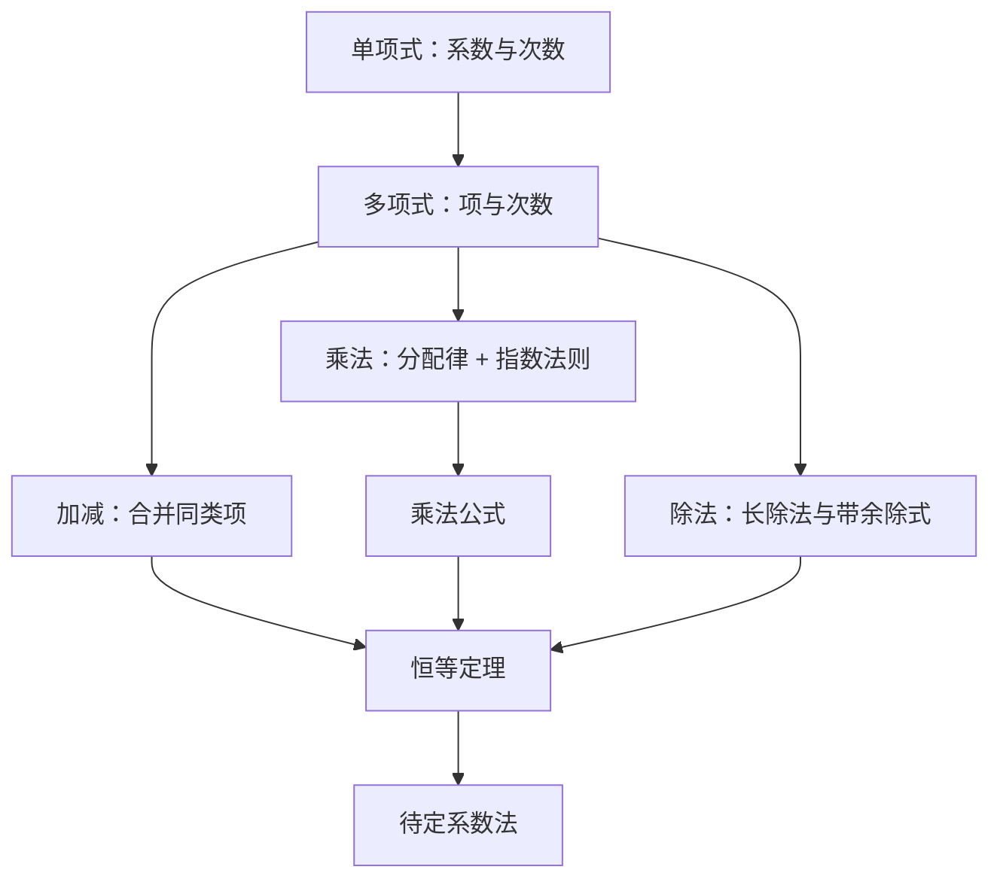

# 整式 点化学习系统

## 这本书在讲什么
整式是“用字母表示数”之后的第一套运算系统。全书只做三件事：把同类项并起来（加减）、按分配律与指数法则展开（乘法）、按指数法则反过来收（除法），最后用恒等定理说明“两个多项式什么时候算同一个东西”。

## 全书心智模型

## 学习路径（推荐顺序）
| 步骤 | 章节 | 主题 | 前置 | 检查点 |
|---|---|---|---|---|
| 01 | ch01 | 整式的概念与加减法 | 数与字母、分配律 | 能判断同类项并化简含括号的多项式 |
| 02 | ch02 | 整式的乘法与乘法公式 | ch01 | 能默写三个乘法公式并逆用 |
| 03 | ch03 | 整式的除法 | ch02 | 能做多项式长除法并写出带余除式 |
| 04 | ch04 | 多项式恒等定理与待定系数法 | ch03 | 能设系数解出使两式恒等的参数 |

## 章节索引
- 第 1 章：整式的概念与加减法（难度 ★）→ chapters/ch01-concept-add-subtract.md
- 第 2 章：整式的乘法与乘法公式（难度 ★★）→ chapters/ch02-multiplication.md
- 第 3 章：整式的除法（难度 ★★）→ chapters/ch03-division.md
- 第 4 章：多项式恒等定理与待定系数法（难度 ★★★）→ chapters/ch04-identity.md

## 前置知识（零基础缺口补讲）
| 缺口 | 对应补讲位置 | 学完标志 |
|---|---|---|
| 同底数幂的指数法则记混 | ch02「单项式乘单项式」 | 能说明 a^m·a^n=a^(m+n) 为什么是指数相加 |
| 去括号时符号出错 | ch01「去括号与添括号」 | 能说出括号前是负号时每一项都要变号的理由 |

## 术语 / 模式 / 速查入口
- 术语表 → glossary.md
- 模式库 → patterns.md
- 速查表 → cheatsheet.md
- 测验 → quiz.md
- 抽认卡 → flashcards.md
