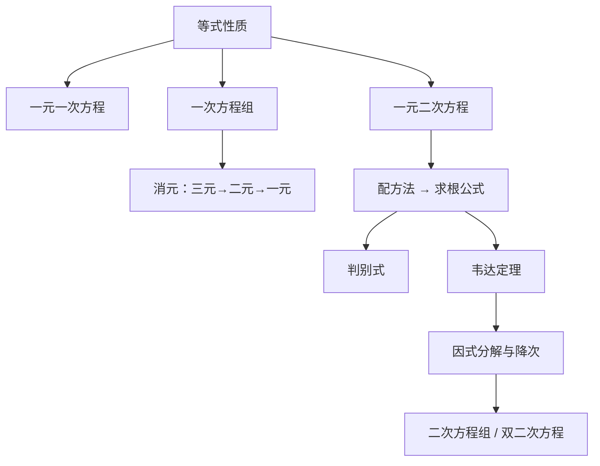

# 一次方程与二次方程 点化学习系统

## 这本书在讲什么
方程的技术只有一条：在等式两边同时做同一件事，解集不变。全书靠这一条把一次方程、一次方程组、二次方程串起来，最后用“降次”和“消元”处理二次方程组。

## 全书心智模型

## 学习路径（推荐顺序）
| 步骤 | 章节 | 主题 | 前置 | 检查点 |
|---|---|---|---|---|
| 01 | ch01 | 一元一次方程 | 等式性质、四则运算 | 能讨论 ax+b=0 的三种解情形 |
| 02 | ch02 | 一次方程组 | ch01 | 能用加减消元解三元方程组 |
| 03 | ch03 | 一元二次方程 | ch02、配方 | 能默写求根公式并用判别式判断根 |
| 04 | ch04 | 二次方程组与可化归方程 | ch03 | 能消元解二次方程组并验根 |

## 章节索引
- 第 1 章：一元一次方程（难度 ★）→ chapters/ch01-linear-equation.md
- 第 2 章：一次方程组（难度 ★★）→ chapters/ch02-linear-systems.md
- 第 3 章：一元二次方程（难度 ★★★）→ chapters/ch03-quadratic-equation.md
- 第 4 章：二次方程组与可化归方程（难度 ★★★）→ chapters/ch04-reducible.md

## 前置知识（零基础缺口补讲）
| 缺口 | 对应补讲位置 | 学完标志 |
|---|---|---|
| 移项时忘记变号 | ch01「移项就是两边同加」 | 能说出移项为什么等价于两边加相反数 |
| 不会配方 | ch03「配方法」 | 能把 x²+6x+5 写成 (x+3)²−4 |
| 解分式方程不验根 | ch04「可化归方程」 | 能举出一个产生增根的例子 |

## 术语 / 模式 / 速查入口
- 术语表 → glossary.md
- 模式库 → patterns.md
- 速查表 → cheatsheet.md
- 测验 → quiz.md
- 抽认卡 → flashcards.md
