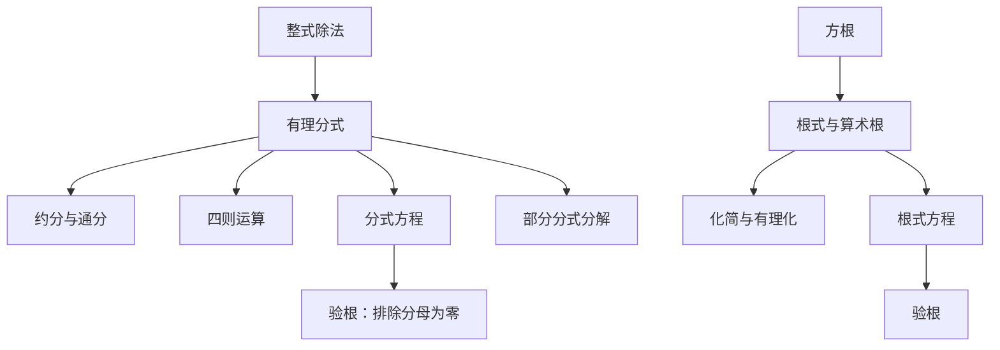

# 分式与根式 点化学习系统

## 这本书在讲什么
分式与根式是代数里最容易出错的两块，因为它们都自带定义域限制：分母不能为零，偶次根号下不能为负。全书围绕两件事展开——在限制条件下做运算，以及在变形后把扩大进来的“假解”筛掉。

## 全书心智模型

## 学习路径（推荐顺序）
| 步骤 | 章节 | 主题 | 前置 | 检查点 |
|---|---|---|---|---|
| 01 | ch01 | 有理分式的概念与运算 | 整式、因式分解 | 能把复杂分式化为最简分式 |
| 02 | ch02 | 分式方程与同解原理 | ch01 | 能解分式方程并说明增根来自哪里 |
| 03 | ch03 | 部分分式 | ch02、待定系数法 | 能把真分式拆成简单分式之和 |
| 04 | ch04 | 根式与算术根 | 开方、绝对值 | 能化简根式并做分母有理化 |

## 章节索引
- 第 1 章：有理分式的概念与运算（难度 ★★）→ chapters/ch01-rational-expression.md
- 第 2 章：分式方程与同解原理（难度 ★★★）→ chapters/ch02-fractional-equation.md
- 第 3 章：部分分式（难度 ★★★）→ chapters/ch03-partial-fraction.md
- 第 4 章：根式与算术根（难度 ★★）→ chapters/ch04-radical.md

## 前置知识（零基础缺口补讲）
| 缺口 | 对应补讲位置 | 学完标志 |
|---|---|---|
| 约分时约掉了加减项 | ch01「约分只能约因式」 | 能说明 (x+1)/(x+2) 不能约成 1/2 |
| 去分母后不验根 | ch02「增根的来源」 | 能举出一个产生增根的分式方程 |
| 以为 √(a²)=a | ch04「算术根」 | 能说明 a<0 时 √(a²)=−a |

## 术语 / 模式 / 速查入口
- 术语表 → glossary.md
- 模式库 → patterns.md
- 速查表 → cheatsheet.md
- 测验 → quiz.md
- 抽认卡 → flashcards.md
