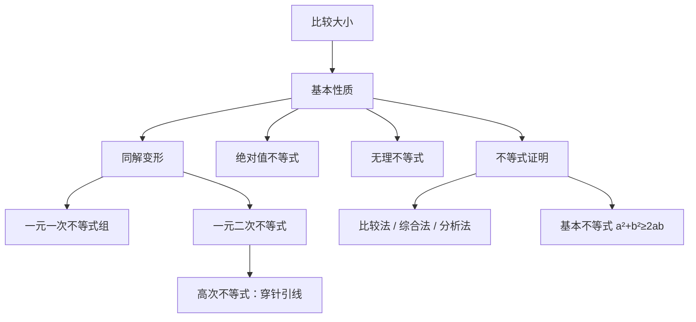

# 不等式 点化学习系统

## 这本书在讲什么
不等式研究的不是“等于多少”，而是“在哪个范围内”。全书三条线：性质（哪些变形保号）、解法（把不等式化成区间）、证明（从已知不等式推出新的）。核心风险只有一处——两边乘除负数要变号。

## 全书心智模型

## 学习路径（推荐顺序）
| 步骤 | 章节 | 主题 | 前置 | 检查点 |
|---|---|---|---|---|
| 01 | ch01 | 性质与同解变形 | 实数比较大小 | 能说明两边乘负数为什么要变号 |
| 02 | ch02 | 二次与高次不等式 | ch01、因式分解 | 能用符号表写出解集 |
| 03 | ch03 | 绝对值与无理不等式 | ch02 | 能先定定义域再解无理不等式 |
| 04 | ch04 | 不等式的证明 | ch03 | 能用比较法与综合法各证一题 |

## 章节索引
- 第 1 章：不等式的性质与同解变形（难度 ★★）→ chapters/ch01-properties.md
- 第 2 章：二次不等式与高次不等式（难度 ★★★）→ chapters/ch02-quadratic-poly.md
- 第 3 章：绝对值不等式与无理不等式（难度 ★★★）→ chapters/ch03-absolute-radical.md
- 第 4 章：不等式的证明（难度 ★★★）→ chapters/ch04-proof.md

## 前置知识（零基础缺口补讲）
| 缺口 | 对应补讲位置 | 学完标志 |
|---|---|---|
| 乘负数忘记变号 | ch01「可乘性」 | 能自己举反例说明 a>b 推不出 −a>−b |
| 解集写成“中间”还是“两边”分不清 | ch02「符号表」 | 能画出二次函数的开口与零点位置 |

## 术语 / 模式 / 速查入口
- 术语表 → glossary.md
- 模式库 → patterns.md
- 速查表 → cheatsheet.md
- 测验 → quiz.md
- 抽认卡 → flashcards.md
