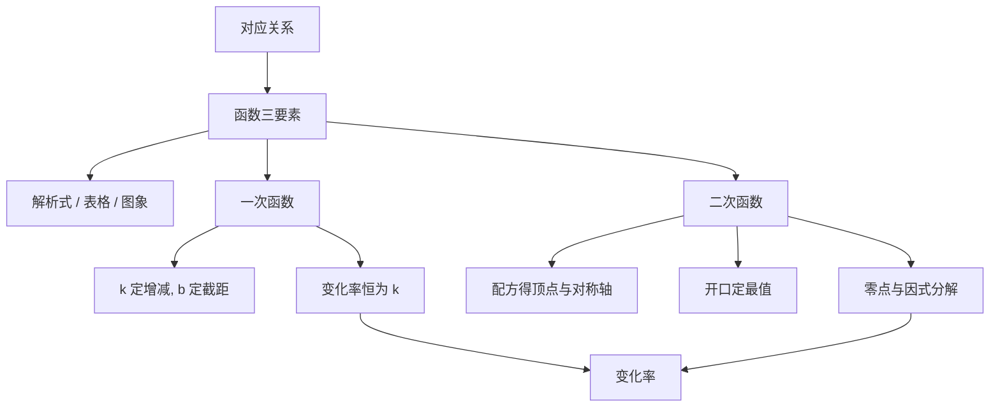

# 一次函数与二次函数 点化学习系统

## 这本书在讲什么
函数是把“输入”变成“输出”的规则。一次函数的图象是直线，变化快慢处处相同；二次函数的图象是抛物线，变化快慢随位置改变。全书用这两条曲线把“变化率”这个概念讲透。

## 全书心智模型

## 学习路径（推荐顺序）
| 步骤 | 章节 | 主题 | 前置 | 检查点 |
|---|---|---|---|---|
| 01 | ch01 | 函数与图象 | 坐标、方程 | 能由一个对应关系写出定义域并画出草图 |
| 02 | ch02 | 一次函数 | ch01 | 能由 k、b 判断增减与截距 |
| 03 | ch03 | 二次函数与变化率 | ch02、配方 | 能求顶点、最值、零点并解释变化率 |

## 章节索引
- 第 1 章：函数与图象（难度 ★★）→ chapters/ch01-function-image.md
- 第 2 章：一次函数（难度 ★★）→ chapters/ch02-linear-function.md
- 第 3 章：二次函数与变化率（难度 ★★★）→ chapters/ch03-quadratic-function.md

## 前置知识（零基础缺口补讲）
| 缺口 | 对应补讲位置 | 学完标志 |
|---|---|---|
| 把函数当成“公式” | ch01「对应关系」 | 能举一个不是公式的函数例子 |
| 配错顶点 | ch03「配方法」 | 能把 y=2x²−8x+5 化成顶点式 |

## 术语 / 模式 / 速查入口
- 术语表 → glossary.md
- 模式库 → patterns.md
- 速查表 → cheatsheet.md
- 测验 → quiz.md
- 抽认卡 → flashcards.md
