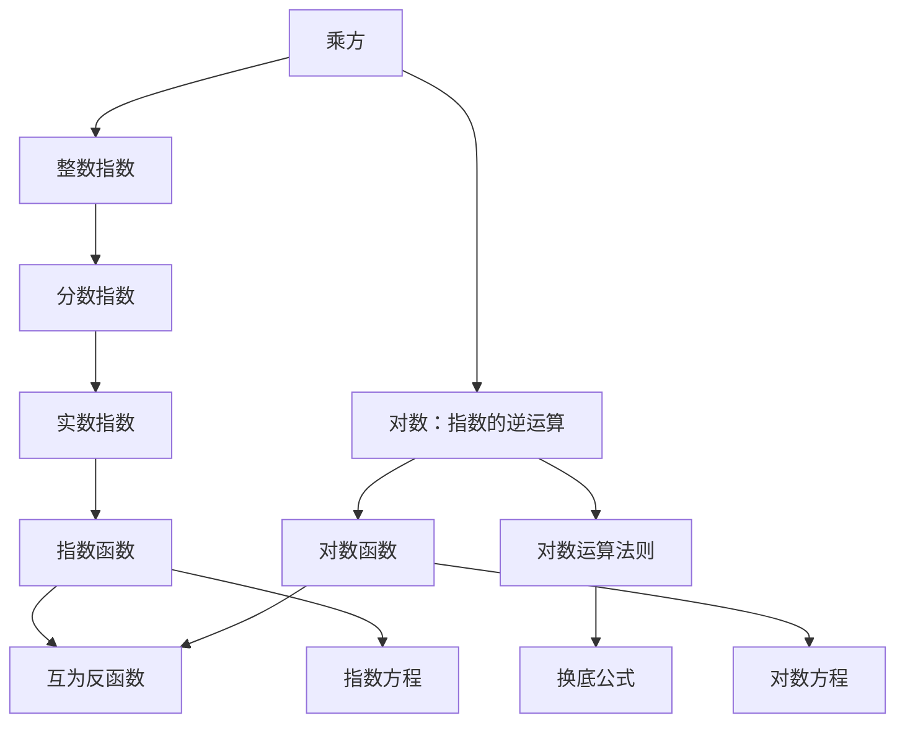

# 指数与对数 点化学习系统

## 这本书在讲什么
指数运算回答“底数乘若干次得多少”，对数运算回答“底数要乘几次才得到它”——两者互为逆运算。全书就是把这两件事的定义、法则、图象与方程串成一条线。

## 全书心智模型

## 学习路径（推荐顺序）
| 步骤 | 章节 | 主题 | 前置 | 检查点 |
|---|---|---|---|---|
| 01 | ch01 | 指数的推广与指数函数 | 乘方、根式 | 能说明 a⁰=1 为什么成立 |
| 02 | ch02 | 对数与对数运算 | ch01 | 能把指数式与对数式互化并用法则化简 |
| 03 | ch03 | 对数函数、幂函数与指对方程 | ch02 | 能解指数方程并验根 |

## 章节索引
- 第 1 章：指数的推广与指数函数（难度 ★★）→ chapters/ch01-exponent.md
- 第 2 章：对数与对数运算（难度 ★★★）→ chapters/ch02-logarithm.md
- 第 3 章：对数函数、幂函数与指对方程（难度 ★★★）→ chapters/ch03-log-function-equations.md

## 前置知识（零基础缺口补讲）
| 缺口 | 对应补讲位置 | 学完标志 |
|---|---|---|
| 把 a⁰ 当成 0 | ch01「零指数」 | 能用 aⁿ/aⁿ=1 说明 a⁰=1 |
| log(M+N)=logM+logN | ch02「运算法则只对乘除」 | 能举反例 |

## 术语 / 模式 / 速查入口
- 术语表 → glossary.md
- 模式库 → patterns.md
- 速查表 → cheatsheet.md
- 测验 → quiz.md
- 抽认卡 → flashcards.md
