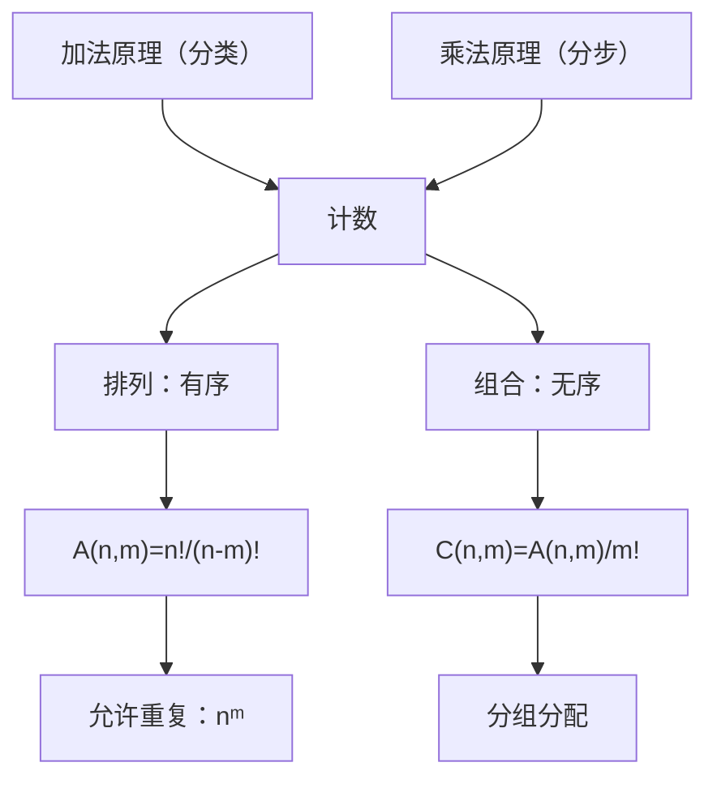

# 排列与组合 点化学习系统

## 这本书在讲什么
计数不是一个个数，而是找结构。全书只靠两条原理：分类相加（加法原理）、分步相乘（乘法原理），其余公式都是它们的推论。判断“有序无序”是选排列还是选组合的唯一标准。

## 全书心智模型

## 学习路径（推荐顺序）
| 步骤 | 章节 | 主题 | 前置 | 检查点 |
|---|---|---|---|---|
| 01 | ch01 | 两条原理与排列 | 乘法、阶乘 | 能判断一道题该加还是该乘 |
| 02 | ch02 | 组合与组合数 | ch01 | 能判断有序无序并选出正确公式 |
| 03 | ch03 | 可重复排列与分组分配 | ch02 | 能把分组问题按“均匀/非均匀”分开处理 |

## 章节索引
- 第 1 章：两条原理与排列（难度 ★★）→ chapters/ch01-principles-permutation.md
- 第 2 章：组合与组合数（难度 ★★）→ chapters/ch02-combination.md
- 第 3 章：可重复排列与分组分配（难度 ★★★）→ chapters/ch03-repeat-grouping.md

## 前置知识（零基础缺口补讲）
| 缺口 | 对应补讲位置 | 学完标志 |
|---|---|---|
| 该加该乘分不清 | ch01「分类与分步」 | 能用自己的话说明“互斥才加、相依才乘” |
| 组合当排列算 | ch02「有序无序」 | 能说明为什么要除以 m! |

## 术语 / 模式 / 速查入口
- 术语表 → glossary.md
- 模式库 → patterns.md
- 速查表 → cheatsheet.md
- 测验 → quiz.md
- 抽认卡 → flashcards.md
