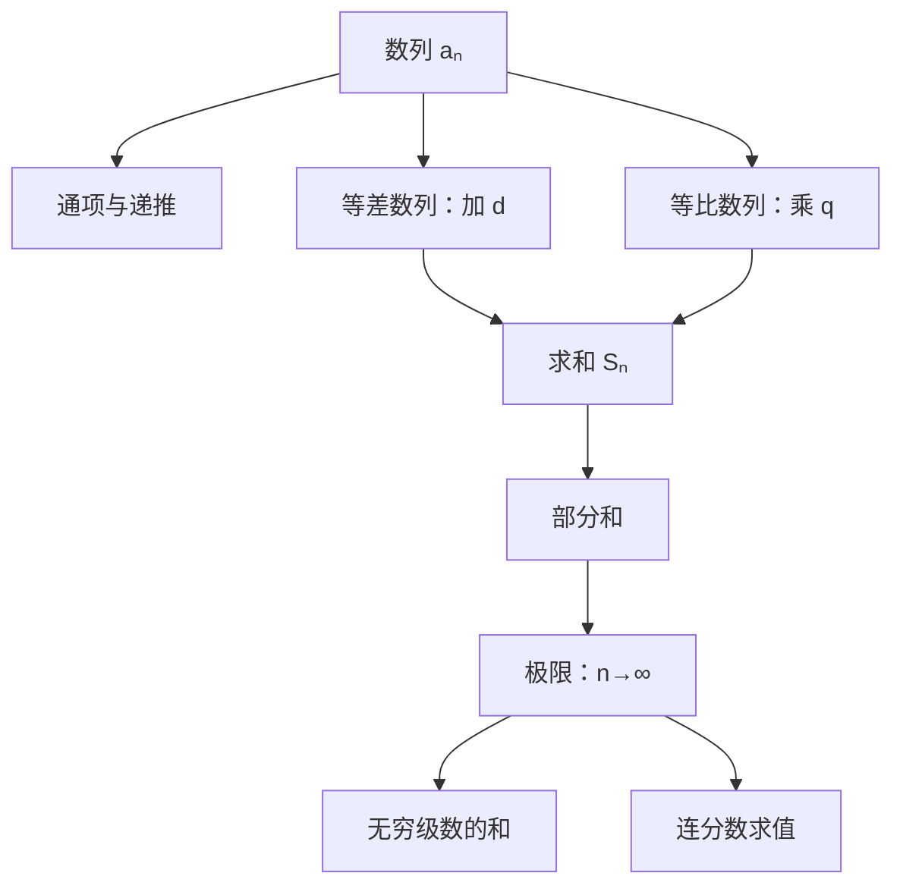

# 数列与极限 点化学习系统

## 这本书在讲什么
数列是按顺序排好的一串数。等差与等比的差别只在“每一步加固定量”还是“乘固定倍数”。把有限项的和推向无穷，就出现了级数与极限——这是全书真正的重点。

## 全书心智模型

## 学习路径（推荐顺序）
| 步骤 | 章节 | 主题 | 前置 | 检查点 |
|---|---|---|---|---|
| 01 | ch01 | 数列与通项 | 函数、代数式 | 能由一个通项公式写出前几项 |
| 02 | ch02 | 等差数列与等比数列 | ch01 | 能默写两组通项与求和公式 |
| 03 | ch03 | 级数与极限 | ch02 | 能用 |q|<1 求和并解释极限 |

## 章节索引
- 第 1 章：数列与通项（难度 ★★）→ chapters/ch01-sequence.md
- 第 2 章：等差数列与等比数列（难度 ★★）→ chapters/ch02-ap-gp.md
- 第 3 章：级数与极限（难度 ★★★）→ chapters/ch03-series-limit.md

## 前置知识（零基础缺口补讲）
| 缺口 | 对应补讲位置 | 学完标志 |
|---|---|---|
| 把数列当成集合 | ch01「数列是有序的」 | 能说明 1,2,3 与 3,2,1 是不同数列 |
| 等比求和忘记 q≠1 | ch02「求和公式的分情形」 | 能说明 q=1 时公式为何失效 |

## 术语 / 模式 / 速查入口
- 术语表 → glossary.md
- 模式库 → patterns.md
- 速查表 → cheatsheet.md
- 测验 → quiz.md
- 抽认卡 → flashcards.md
