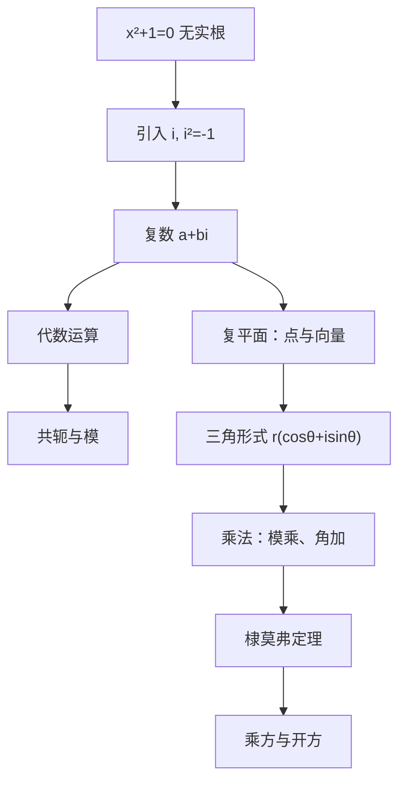

# 复数 点化学习系统

## 这本书在讲什么
负数开平方在实数范围内无解，于是引入 i（i²=−1），把数系扩到复数。复数不是凭空造出来的记号，它对应平面上的一个点或一个向量：加法是平移，乘法是“旋转＋伸缩”。抓住这个几何意义，所有公式都有出处。

## 全书心智模型

## 学习路径（推荐顺序）
| 步骤 | 章节 | 主题 | 前置 | 检查点 |
|---|---|---|---|---|
| 01 | ch01 | 数系扩张与复数概念 | 实数、一元二次方程 | 能说明为什么需要虚数单位 |
| 02 | ch02 | 复数的运算与几何意义 | ch01 | 能用共轭做除法并解释模 |
| 03 | ch03 | 三角形式与乘方开方 | ch02、三角 | 能用棣莫弗定理开方并画图 |

## 章节索引
- 第 1 章：数系扩张与复数概念（难度 ★★）→ chapters/ch01-concept.md
- 第 2 章：复数的运算与几何意义（难度 ★★★）→ chapters/ch02-operations-geometry.md
- 第 3 章：三角形式与乘方开方（难度 ★★★）→ chapters/ch03-trig-polar.md

## 前置知识（零基础缺口补讲）
| 缺口 | 对应补讲位置 | 学完标志 |
|---|---|---|
| 把 i 当成普通字母 | ch01「i²=−1 是定义」 | 能算出 i³、i⁴ |
| 除法不会处理分母的 i | ch02「共轭有理化」 | 能算出 1/(1+i) |

## 术语 / 模式 / 速查入口
- 术语表 → glossary.md
- 模式库 → patterns.md
- 速查表 → cheatsheet.md
- 测验 → quiz.md
- 抽认卡 → flashcards.md
