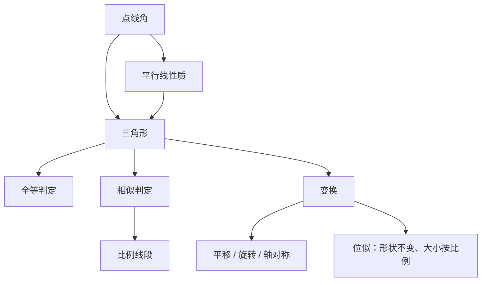

# 直线形 点化学习系统

## 这本书在讲什么
平面几何研究的对象是“由直线段围成的图形”。全书从最基本的角讲起，用平行线把角的关系固定下来，再用全等与相似判断两个图形是否“一样”或“成比例”，最后用变换把图形搬动而不改变形状。

## 全书心智模型

## 学习路径（推荐顺序）
| 步骤 | 章节 | 主题 | 前置 | 检查点 |
|---|---|---|---|---|
| 01 | ch01 | 角与平行线 | 基本作图 | 能用平行线性质推出角相等 |
| 02 | ch02 | 三角形与全等 | ch01 | 能选出正确的全等判定条件 |
| 03 | ch03 | 相似、比例与变换 | ch02 | 能用相似比求线段长 |

## 章节索引
- 第 1 章：角与平行线（难度 ★★）→ chapters/ch01-angles-parallel.md
- 第 2 章：三角形与全等（难度 ★★）→ chapters/ch02-triangle-congruence.md
- 第 3 章：相似、比例与图形变换（难度 ★★★）→ chapters/ch03-similarity-transform.md

## 前置知识（零基础缺口补讲）
| 缺口 | 对应补讲位置 | 学完标志 |
|---|---|---|
| 分不清对应边与对应角 | ch02「全等的对应关系」 | 能按字母顺序写出对应关系 |
| 相似比与面积比混用 | ch03「相似比与面积比」 | 能说明面积比是相似比的平方 |

## 术语 / 模式 / 速查入口
- 术语表 → glossary.md
- 模式库 → patterns.md
- 速查表 → cheatsheet.md
- 测验 → quiz.md
- 抽认卡 → flashcards.md
