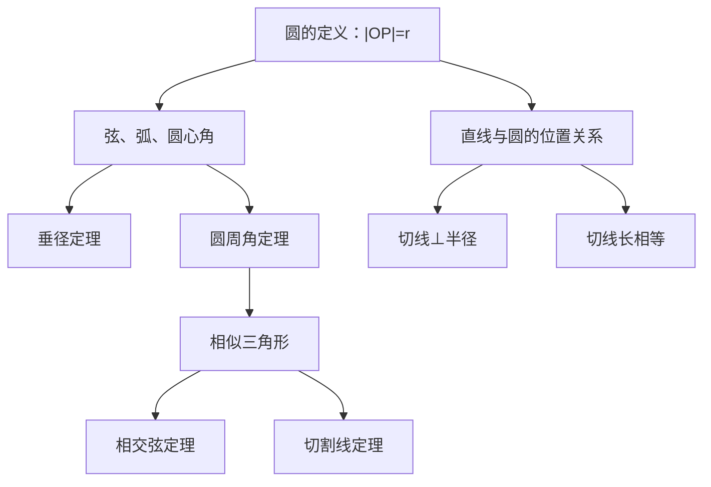

# 圆 点化学习系统

## 这本书在讲什么
圆是“到定点距离相等的所有点”的集合。这一条定义派生出全书的内容：弦与弧决定角的大小，圆心到直线的距离决定相交、相切还是相离，切线垂直于半径，而相交弦与切割线定理本质都是相似三角形。

## 全书心智模型

## 学习路径（推荐顺序）
| 步骤 | 章节 | 主题 | 前置 | 检查点 |
|---|---|---|---|---|
| 01 | ch01 | 圆的基本性质 | 垂径、圆周角 | 能由圆周角推出圆心角 |
| 02 | ch02 | 直线与圆的位置关系 | ch01 | 能用 d 与 r 判断位置关系并作切线 |
| 03 | ch03 | 比例线段与圆内接四边形 | ch02、相似 | 能用相交弦定理求线段长 |

## 章节索引
- 第 1 章：圆的基本性质（难度 ★★）→ chapters/ch01-basic-properties.md
- 第 2 章：直线与圆的位置关系（难度 ★★）→ chapters/ch02-line-circle.md
- 第 3 章：比例线段与圆内接四边形（难度 ★★★）→ chapters/ch03-proportion.md

## 前置知识（零基础缺口补讲）
| 缺口 | 对应补讲位置 | 学完标志 |
|---|---|---|
| 圆心角与圆周角混用 | ch01「两类角」 | 能说明同弧圆周角是圆心角的一半 |
| 切线与割线分不清 | ch02「切线性质」 | 能指出切线只有一个公共点 |

## 术语 / 模式 / 速查入口
- 术语表 → glossary.md
- 模式库 → patterns.md
- 速查表 → cheatsheet.md
- 测验 → quiz.md
- 抽认卡 → flashcards.md
