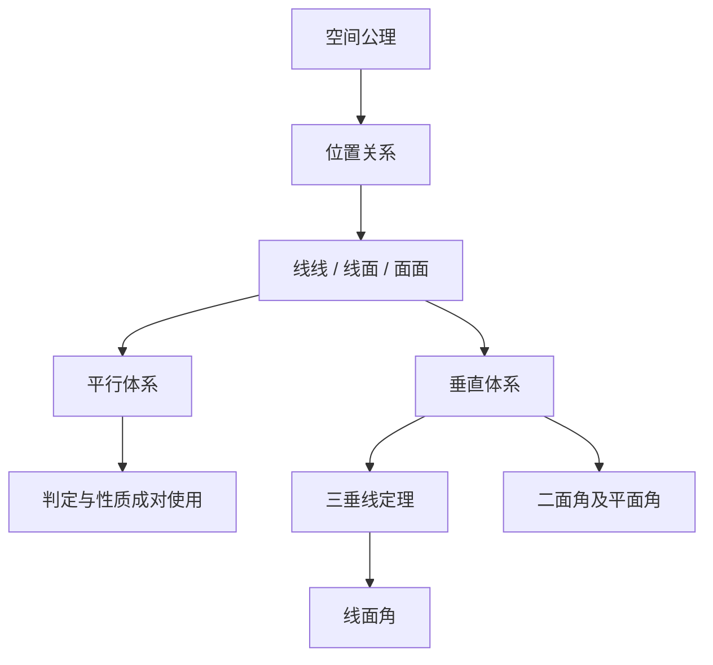

# 直线与平面 点化学习系统

## 这本书在讲什么
平面几何里“两条直线不相交就平行”，到了空间就不成立——它们可能异面。全书先建立空间的基本公理，再用“判定—性质”成对出现的定理处理平行与垂直，最后用角来度量空间的倾斜程度。

## 全书心智模型

## 学习路径（推荐顺序）
| 步骤 | 章节 | 主题 | 前置 | 检查点 |
|---|---|---|---|---|
| 01 | ch01 | 空间的位置关系与平行 | 平面几何 | 能举出异面直线的例子 |
| 02 | ch02 | 垂直关系与三垂线定理 | ch01 | 能用判定定理证线面垂直 |
| 03 | ch03 | 空间角与距离 | ch02 | 能作出二面角的平面角 |

## 章节索引
- 第 1 章：空间的位置关系与平行（难度 ★★）→ chapters/ch01-parallel.md
- 第 2 章：垂直关系与三垂线定理（难度 ★★★）→ chapters/ch02-perpendicular.md
- 第 3 章：空间角与距离（难度 ★★★）→ chapters/ch03-angles-distance.md

## 前置知识（零基础缺口补讲）
| 缺口 | 对应补讲位置 | 学完标志 |
|---|---|---|
| 以为不相交就平行 | ch01「异面直线」 | 能说明空间中两直线有三种关系 |
| 证明垂直只画图不写依据 | ch02「判定定理」 | 能按“因为…所以…”写出完整推理 |

## 术语 / 模式 / 速查入口
- 术语表 → glossary.md
- 模式库 → patterns.md
- 速查表 → cheatsheet.md
- 测验 → quiz.md
- 抽认卡 → flashcards.md
