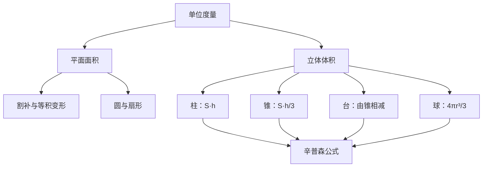

# 面积与体积 点化学习系统

## 这本书在讲什么
面积与体积不是背公式，而是“用已知量拼出未知量”。全书的主线是割补与极限：把不规则图形切成规则小块，再让块数无限增多。辛普森公式把柱、锥、台、球统一成同一个式子，是全书的高潮。

## 全书心智模型

## 学习路径（推荐顺序）
| 步骤 | 章节 | 主题 | 前置 | 检查点 |
|---|---|---|---|---|
| 01 | ch01 | 平面图形的面积 | 长度、相似 | 能用割补法求不规则图形面积 |
| 02 | ch02 | 圆、扇形与曲线形面积 | ch01、圆周率 | 能用极限思想说明圆面积公式 |
| 03 | ch03 | 立体图形的体积 | ch02 | 能用辛普森公式统一求柱锥台球 |

## 章节索引
- 第 1 章：平面图形的面积（难度 ★★）→ chapters/ch01-plane-area.md
- 第 2 章：圆、扇形与曲线形面积（难度 ★★★）→ chapters/ch02-circle-area.md
- 第 3 章：立体图形的体积（难度 ★★★）→ chapters/ch03-solid-volume.md

## 前置知识（零基础缺口补讲）
| 缺口 | 对应补讲位置 | 学完标志 |
|---|---|---|
| 把周长与面积混为一谈 | ch02「一维与二维」 | 能说明周长加倍时面积变四倍 |
| 锥的体积忘记除以 3 | ch03「锥的体积」 | 能用三个锥拼成一个柱来说明 1/3 |

## 术语 / 模式 / 速查入口
- 术语表 → glossary.md
- 模式库 → patterns.md
- 速查表 → cheatsheet.md
- 测验 → quiz.md
- 抽认卡 → flashcards.md
