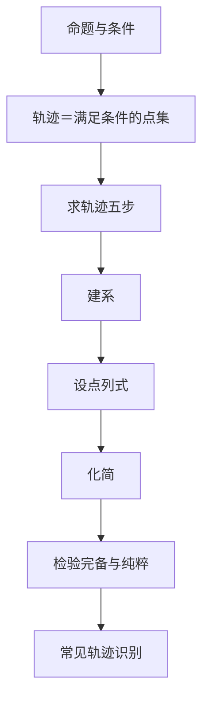

# 轨迹 点化学习系统

## 这本书在讲什么
轨迹是“满足某条件的点所组成的集合”。求轨迹就是把这个几何条件翻译成代数方程，再反过来检查方程上的点是否都满足条件——这两步分别叫完备性与纯粹性，缺一不可。全书前半讲逻辑（充分必要），后半讲翻译与检验。

## 全书心智模型

## 学习路径（推荐顺序）
| 步骤 | 章节 | 主题 | 前置 | 检查点 |
|---|---|---|---|---|
| 01 | ch01 | 命题与充分必要条件 | 逻辑常识 | 能判断“甲是乙的什么条件” |
| 02 | ch02 | 求轨迹的五步法 | ch01、坐标 | 能独立完成一道轨迹题的检验 |
| 03 | ch03 | 常见轨迹与空间轨迹 | ch02 | 能由条件说出轨迹类型 |

## 章节索引
- 第 1 章：命题与充分必要条件（难度 ★★）→ chapters/ch01-logic-conditions.md
- 第 2 章：求轨迹的五步法（难度 ★★★）→ chapters/ch02-five-steps.md
- 第 3 章：常见轨迹与空间轨迹（难度 ★★★）→ chapters/ch03-common-locus.md

## 前置知识（零基础缺口补讲）
| 缺口 | 对应补讲位置 | 学完标志 |
|---|---|---|
| 充分与必要搞反 | ch01「p⇒q 的方向」 | 能用“小范围推大范围”判断充分 |
| 求出方程就交卷，不检验 | ch02「完备性与纯粹性」 | 能举出一个需要去掉增点的例子 |

## 术语 / 模式 / 速查入口
- 术语表 → glossary.md
- 模式库 → patterns.md
- 速查表 → cheatsheet.md
- 测验 → quiz.md
- 抽认卡 → flashcards.md
