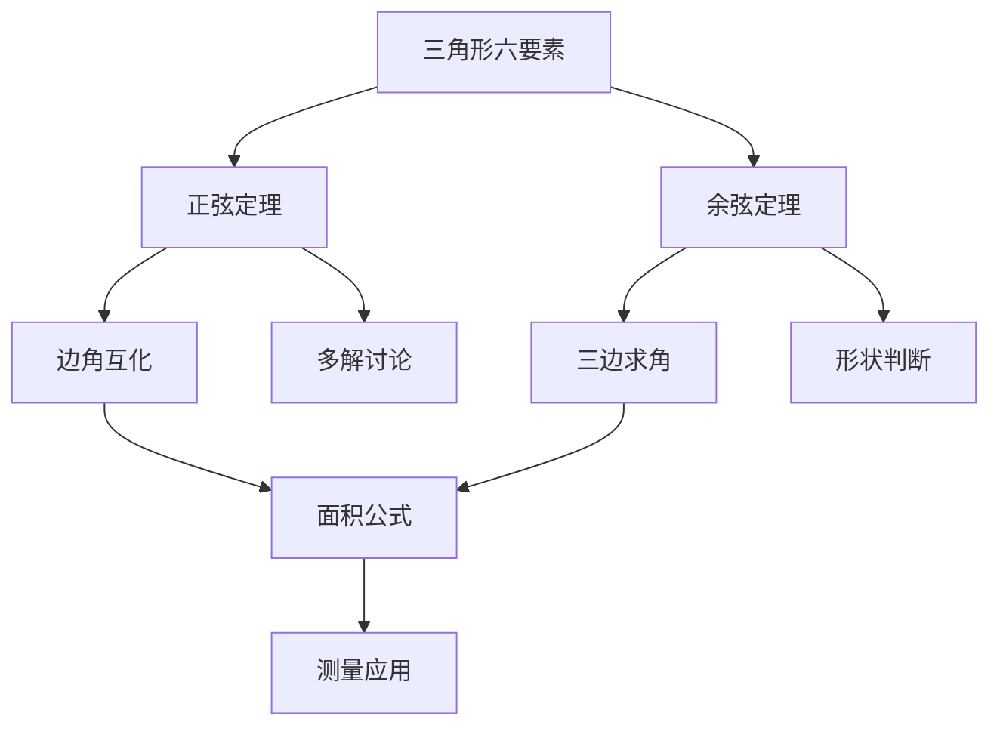

# 解三角形 点化学习系统

## 这本书在讲什么
解三角形就是“由已知元素求未知元素”。三个角、三条边里只要知道三个（至少含一条边），三角形就定了。正弦定理管“边角对应”，余弦定理管“两边夹一角”，面积公式管“面积”。全书的核心风险是多解：已知两边及一边对角时，可能有两个三角形。

## 全书心智模型

## 学习路径（推荐顺序）
| 步骤 | 章节 | 主题 | 前置 | 检查点 |
|---|---|---|---|---|
| 01 | ch01 | 正弦定理 | 三角比、圆 | 能由两边一角求出其余元素并讨论多解 |
| 02 | ch02 | 余弦定理与形状判断 | ch01 | 能由三边求角并判断三角形类型 |
| 03 | ch03 | 面积公式与应用 | ch02 | 能用两种面积公式解测量题 |

## 章节索引
- 第 1 章：正弦定理（难度 ★★）→ chapters/ch01-sine-rule.md
- 第 2 章：余弦定理与形状判断（难度 ★★）→ chapters/ch02-cosine-rule.md
- 第 3 章：面积公式与应用（难度 ★★）→ chapters/ch03-area-application.md

## 前置知识（零基础缺口补讲）
| 缺口 | 对应补讲位置 | 学完标志 |
|---|---|---|
| 正弦定理求出角后忘了可能有两解 | ch01「多解讨论」 | 能画图说明为什么有两个三角形 |
| 余弦定理符号记错 | ch02「公式结构」 | 能说明为什么是减 2bc cosA |

## 术语 / 模式 / 速查入口
- 术语表 → glossary.md
- 模式库 → patterns.md
- 速查表 → cheatsheet.md
- 测验 → quiz.md
- 抽认卡 → flashcards.md
