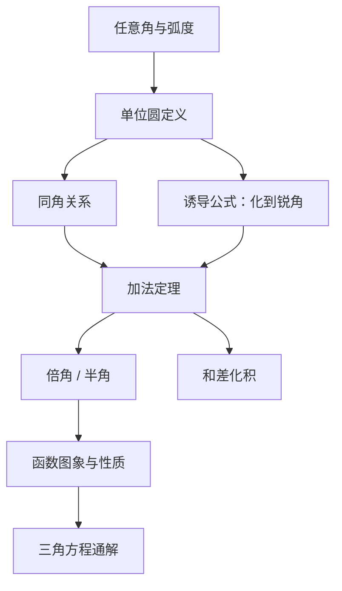

# 三角函数 点化学习系统

## 这本书在讲什么
三角函数把“角”变成“数”：在单位圆上，角对应一个点，点的坐标就是余弦与正弦。全书从角的推广讲到波形，核心是把几何里的角转成可以运算的函数，再用周期性描述一切往复变化。

## 全书心智模型

## 学习路径（推荐顺序）
| 步骤 | 章节 | 主题 | 前置 | 检查点 |
|---|---|---|---|---|
| 01 | ch01 | 角、弧度与三角比 | 相似、坐标 | 能把任意角化到 0°~360°并说出象限 |
| 02 | ch02 | 同角关系与诱导公式 | ch01 | 能把任意角的三角比化成锐角 |
| 03 | ch03 | 加法定理与倍角 | ch02 | 能默写和角、差角与二倍角公式 |
| 04 | ch04 | 图象、性质与三角方程 | ch03 | 能说出周期、对称轴并写通解 |

## 章节索引
- 第 1 章：角、弧度与三角比（难度 ★★）→ chapters/ch01-angle-radian.md
- 第 2 章：同角关系与诱导公式（难度 ★★）→ chapters/ch02-identities.md
- 第 3 章：加法定理与倍角公式（难度 ★★★）→ chapters/ch03-addition.md
- 第 4 章：图象、性质与三角方程（难度 ★★★）→ chapters/ch04-graphs-equations.md

## 前置知识（零基础缺口补讲）
| 缺口 | 对应补讲位置 | 学完标志 |
|---|---|---|
| 角度与弧度混用 | ch01「两种度量」 | 能说明 180°=π 弧度 |
| 诱导公式符号判断错 | ch02「象限定符号」 | 能画单位圆判断 sin(180°+θ) 的符号 |

## 术语 / 模式 / 速查入口
- 术语表 → glossary.md
- 模式库 → patterns.md
- 速查表 → cheatsheet.md
- 测验 → quiz.md
- 抽认卡 → flashcards.md
