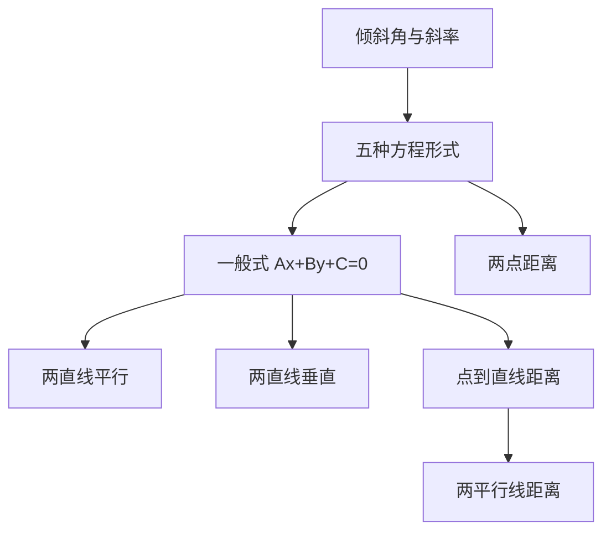

# 直线方程 点化学习系统

## 这本书在讲什么
解析几何的第一步是把“直线”翻译成“方程”。全书围绕两件事：一条直线的方程怎么写出来（五种形式各有适用条件），两条直线的位置关系怎么用斜率与系数判断。所有公式都从“斜率＝倾斜程度”这一个量出发。

## 全书心智模型

## 学习路径（推荐顺序）
| 步骤 | 章节 | 主题 | 前置 | 检查点 |
|---|---|---|---|---|
| 01 | ch01 | 倾斜角与斜率 | 坐标、三角比 | 能由两点求斜率并判断倾斜角范围 |
| 02 | ch02 | 直线方程的五种形式 | ch01 | 能按条件选对形式并注明适用条件 |
| 03 | ch03 | 位置关系与距离 | ch02 | 能用一般式系数判断平行垂直 |

## 章节索引
- 第 1 章：倾斜角与斜率（难度 ★★）→ chapters/ch01-slope.md
- 第 2 章：直线方程的五种形式（难度 ★★）→ chapters/ch02-forms.md
- 第 3 章：位置关系与距离（难度 ★★★）→ chapters/ch03-position-distance.md

## 前置知识（零基础缺口补讲）
| 缺口 | 对应补讲位置 | 学完标志 |
|---|---|---|
| 斜率不存在时仍套点斜式 | ch01「竖直直线」 | 能说明 x=2 为什么没有斜率 |
| 截距式忽略过原点 | ch02「适用条件」 | 能指出截距式在过原点时失效 |

## 术语 / 模式 / 速查入口
- 术语表 → glossary.md
- 模式库 → patterns.md
- 速查表 → cheatsheet.md
- 测验 → quiz.md
- 抽认卡 → flashcards.md
