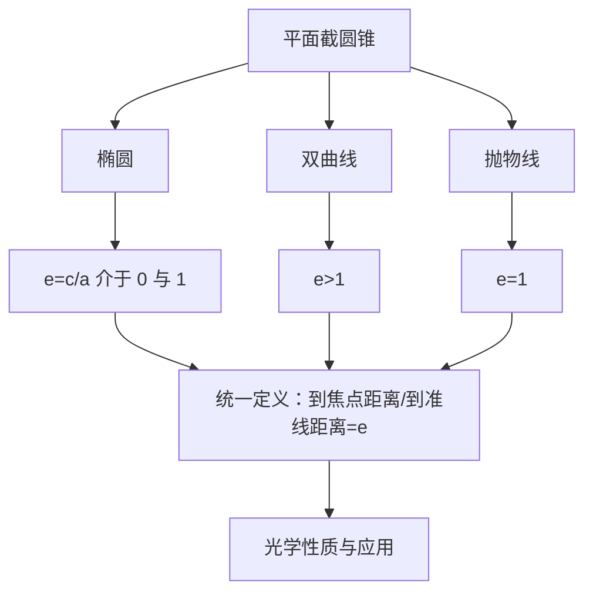

# 圆锥曲线 点化学习系统

## 这本书在讲什么
用一个平面去切圆锥，随着切的角度变化，截线依次是椭圆、抛物线、双曲线——这是它们被统称“圆锥曲线”的原因。三者的定义都能写成“到定点与定直线（或两定点）的距离关系”，差别只在离心率 e 的取值。抓住 e，就抓住了这三条曲线的统一性。

## 全书心智模型

## 学习路径（推荐顺序）
| 步骤 | 章节 | 主题 | 前置 | 检查点 |
|---|---|---|---|---|
| 01 | ch01 | 椭圆 | 两点距离、配方 | 能由方程读出 a、b、c、e |
| 02 | ch02 | 双曲线与抛物线 | ch01 | 能写出渐近线与准线 |
| 03 | ch03 | 统一定义、光学性质与坐标变换 | ch02 | 能用 e 判断曲线类型 |

## 章节索引
- 第 1 章：椭圆（难度 ★★★）→ chapters/ch01-ellipse.md
- 第 2 章：双曲线与抛物线（难度 ★★★）→ chapters/ch02-hyperbola-parabola.md
- 第 3 章：统一定义、光学性质与坐标变换（难度 ★★★）→ chapters/ch03-unified-optics.md

## 前置知识（零基础缺口补讲）
| 缺口 | 对应补讲位置 | 学完标志 |
|---|---|---|
| a、b、c 关系记混 | ch01「三者关系」 | 能说明椭圆 b²=a²−c²、双曲线 b²=c²−a² |
| 把离心率当成斜率 | ch01「离心率的含义」 | 能说明 e 越接近 1 椭圆越扁 |

## 术语 / 模式 / 速查入口
- 术语表 → glossary.md
- 模式库 → patterns.md
- 速查表 → cheatsheet.md
- 测验 → quiz.md
- 抽认卡 → flashcards.md
