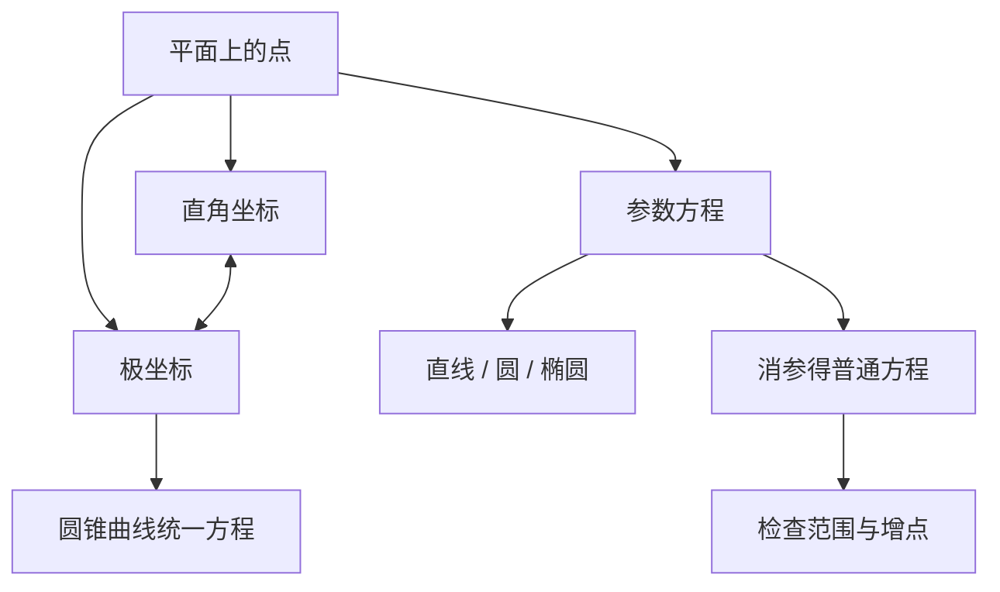

# 极坐标与参数方程 点化学习系统

## 这本书在讲什么
同一根曲线可以有很多写法。极坐标用“距离＋角度”定位，适合描述旋转与放射状图形；参数方程用“第三个变量 t”同时表示 x 与 y，适合描述运动。全书教两件事：怎么换坐标，以及换了之后怎么不丢信息（范围限制）。

## 全书心智模型

## 学习路径（推荐顺序）
| 步骤 | 章节 | 主题 | 前置 | 检查点 |
|---|---|---|---|---|
| 01 | ch01 | 极坐标 | 坐标、三角比 | 能把极坐标方程与直角坐标方程互化 |
| 02 | ch02 | 参数方程 | ch01 | 能写出常见曲线的参数方程并消参 |
| 03 | ch03 | 互化与范围检查 | ch02 | 能指出消参后丢失的点 |

## 章节索引
- 第 1 章：极坐标（难度 ★★）→ chapters/ch01-polar.md
- 第 2 章：参数方程（难度 ★★）→ chapters/ch02-parametric.md
- 第 3 章：互化、范围与最值（难度 ★★★）→ chapters/ch03-conversion-extremum.md

## 前置知识（零基础缺口补讲）
| 缺口 | 对应补讲位置 | 学完标志 |
|---|---|---|
| 极坐标里 ρ 可以为负就懵 | ch01「ρ 的符号」 | 能说明 ρ<0 时点在哪里 |
| 消参后忘记写范围 | ch03「范围限制」 | 能举出一个消参后多出半条曲线的例子 |

## 术语 / 模式 / 速查入口
- 术语表 → glossary.md
- 模式库 → patterns.md
- 速查表 → cheatsheet.md
- 测验 → quiz.md
- 抽认卡 → flashcards.md
