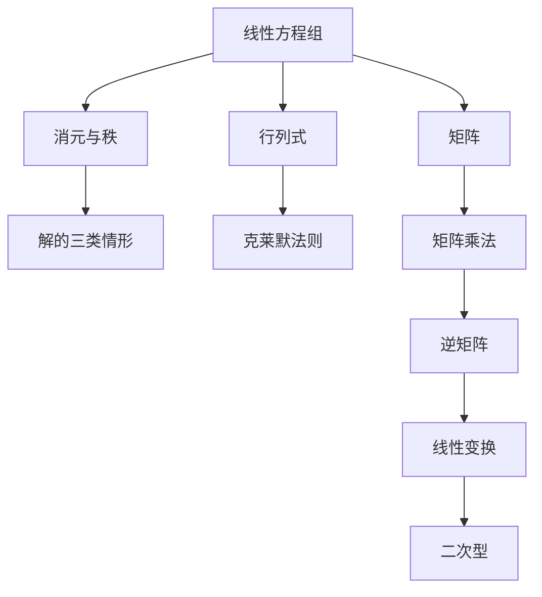

# 线性方程组与矩阵 点化学习系统

## 这本书在讲什么
线性方程组是“多个一次方程联立”，矩阵是把它们的系数抽出来排成一张表。用矩阵做消元，判定解的存在与唯一就变成数一数“有效方程的个数”。行列式给出一条直接判断唯一解的公式；矩阵乘法则是线性变换的语言。整本书的主线是：方程组 → 矩阵 → 行列式 → 变换。

## 全书心智模型

## 学习路径（推荐顺序）
| 步骤 | 章节 | 主题 | 前置 | 检查点 |
|---|---|---|---|---|
| 01 | ch01 | 消元法与解的判定 | 一次方程组的解法 | 能说出方程组是无解、唯一解还是无穷多解 |
| 02 | ch02 | 行列式与克莱默法则 | ch01 | 能算三阶行列式并解二元、三元方程组 |
| 03 | ch03 | 矩阵运算与逆矩阵 | ch02 | 能完成矩阵乘法与二阶逆矩阵的求法 |
| 04 | ch04 | 线性变换与二次型 | ch03 | 能用矩阵表示一个线性变换 |

## 章节索引
- 第 1 章：消元法与解的判定（难度 ★★）→ chapters/ch01-elimination.md
- 第 2 章：行列式与克莱默法则（难度 ★★★）→ chapters/ch02-determinant.md
- 第 3 章：矩阵运算与逆矩阵（难度 ★★★）→ chapters/ch03-matrix-algebra.md
- 第 4 章：线性变换与二次型（难度 ★★★）→ chapters/ch04-transform-quadratic.md

## 前置知识（零基础缺口补讲）
| 缺口 | 对应补讲位置 | 学完标志 |
|---|---|---|
| 初等行变换算错系数 | ch01「阶梯形」 | 能把一个三阶方程组化为阶梯形并回代 |
| 逆矩阵公式漏除行列式 | ch03「二阶逆矩阵」 | 能默写 A⁻¹=adj(A)/|A| |

## 术语 / 模式 / 速查入口
- 术语表 → glossary.md
- 模式库 → patterns.md
- 速查表 → cheatsheet.md
- 测验 → quiz.md
- 抽认卡 → flashcards.md
