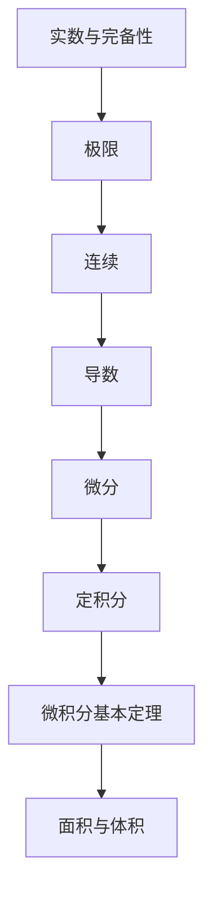

# 微积分初步 点化学习系统

## 这本书在讲什么
微积分解决两个老问题：一是“某一瞬间变化多快”（导数），二是“连续累积起来一共多少”（积分）。两者靠极限连在一起，而极限建立在实数的完备性上。全书按这个顺序展开，每一层都以下一层为地基。

## 全书心智模型

## 学习路径（推荐顺序）
| 步骤 | 章节 | 主题 | 前置 | 检查点 |
|---|---|---|---|---|
| 01 | ch01 | 实数与极限 | 数列、不等式 | 能用 ε-N 说明一个数列趋于某个值 |
| 02 | ch02 | 连续与导数 | ch01 | 能用定义求出简单函数的导数 |
| 03 | ch03 | 微分与积分 | ch02 | 能由导数反求原函数并算定积分 |
| 04 | ch04 | 应用：单调、极值与面积 | ch03 | 能用定积分求曲边图形面积 |

## 章节索引
- 第 1 章：实数与极限（难度 ★★★）→ chapters/ch01-real-limit.md
- 第 2 章：连续与导数（难度 ★★★）→ chapters/ch02-continuity-derivative.md
- 第 3 章：微分与积分（难度 ★★★）→ chapters/ch03-differential-integral.md
- 第 4 章：单调、极值与面积（难度 ★★★）→ chapters/ch04-applications.md

## 前置知识（零基础缺口补讲）
| 缺口 | 对应补讲位置 | 学完标志 |
|---|---|---|
| 极限只看“接近”不看严格定义 | ch01「ε-N 语言」 | 能写出“任意 ε>0，存在 N……”的完整表述 |
| 把导数当成除法 | ch02「导数的定义」 | 能说明 dy/dx 是一个整体记号 |

## 术语 / 模式 / 速查入口
- 术语表 → glossary.md
- 模式库 → patterns.md
- 速查表 → cheatsheet.md
- 测验 → quiz.md
- 抽认卡 → flashcards.md
