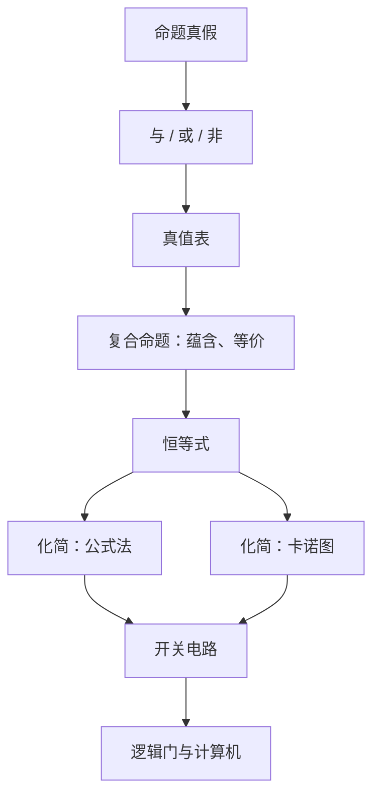

# 逻辑代数初步 点化学习系统

## 这本书在讲什么
普通代数算的是数，逻辑代数算的是“真”与“假”。它只有两个值 1 和 0，但运算规则与算术不同：1+1=1（或）、1·1=1（与）、非 1=0。这套规则既是数学，也是计算机硬件的语言——每一个逻辑门都在执行一条逻辑运算。

## 全书心智模型

## 学习路径（推荐顺序）
| 步骤 | 章节 | 主题 | 前置 | 检查点 |
|---|---|---|---|---|
| 01 | ch01 | 命题与真值表 | 真假概念 | 能列出三变量以内的真值表 |
| 02 | ch02 | 逻辑恒等式与化简 | ch01 | 能把复合表达式化简为最简式 |
| 03 | ch03 | 开关电路与逻辑门 | ch02 | 能把表达式画成电路并实现 |

## 章节索引
- 第 1 章：命题与真值表（难度 ★★）→ chapters/ch01-truth-table.md
- 第 2 章：逻辑恒等式与化简（难度 ★★★）→ chapters/ch02-identities-simplify.md
- 第 3 章：开关电路与逻辑门（难度 ★★）→ chapters/ch03-circuits-gates.md

## 前置知识（零基础缺口补讲）
| 缺口 | 对应补讲位置 | 学完标志 |
|---|---|---|
| 把逻辑加法当成算术加法 | ch01「1+1=1」 | 能说明或运算为什么 1+1=1 |
| 德摩根律记错 | ch02「取反换号」 | 能写出 (A+B)′=A′B′ |

## 术语 / 模式 / 速查入口
- 术语表 → glossary.md
- 模式库 → patterns.md
- 速查表 → cheatsheet.md
- 测验 → quiz.md
- 抽认卡 → flashcards.md
