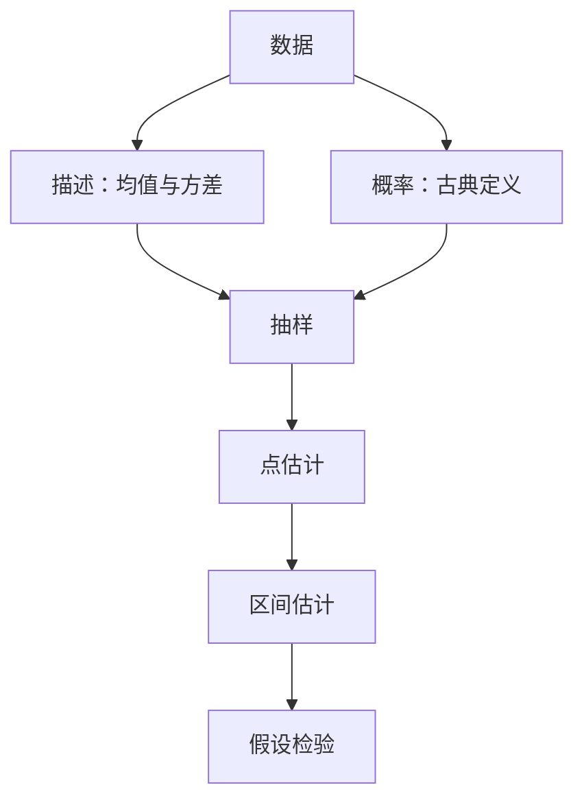

# 数理统计初步 点化学习系统

## 这本书在讲什么
数理统计分两步：先把数据压缩成几个数（平均数、方差），再从样本反推总体（估计与检验）。前者是描述统计，后者是推断统计。连接这两步的是概率：正因为随机抽样有波动，我们才需要用概率语言说“这个结论有多可信”。

## 全书心智模型

## 学习路径（推荐顺序）
| 步骤 | 章节 | 主题 | 前置 | 检查点 |
|---|---|---|---|---|
| 01 | ch01 | 数据的整理与描述 | 平均数、平方 | 能算出均值、中位数与方差 |
| 02 | ch02 | 概率与计数 | 排列组合 | 能求古典概率并判断互斥与独立 |
| 03 | ch03 | 抽样与推断入门 | ch01、ch02 | 能说明样本均值为什么接近总体均值 |

## 章节索引
- 第 1 章：数据的整理与描述（难度 ★★）→ chapters/ch01-descriptive.md
- 第 2 章：概率与计数（难度 ★★）→ chapters/ch02-probability.md
- 第 3 章：抽样与推断入门（难度 ★★★）→ chapters/ch03-inference.md

## 前置知识（零基础缺口补讲）
| 缺口 | 对应补讲位置 | 学完标志 |
|---|---|---|
| 方差分母用 n 还是 n−1 | ch01「样本方差」 | 能说明样本方差为何除以 n−1 |
| 把互斥与独立混为一谈 | ch02「互斥 vs 独立」 | 能举出互斥但不独立的例子 |

## 术语 / 模式 / 速查入口
- 术语表 → glossary.md
- 模式库 → patterns.md
- 速查表 → cheatsheet.md
- 测验 → quiz.md
- 抽认卡 → flashcards.md
